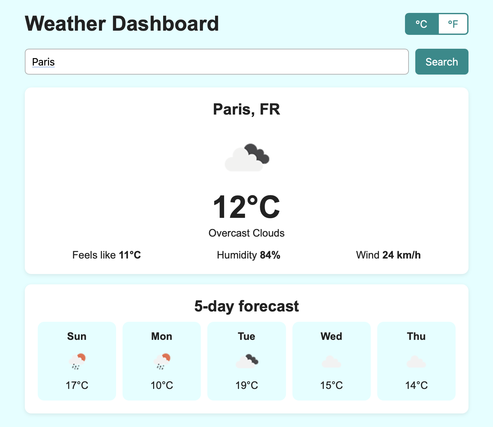

# Assignment 5 - Weather Dashboard in React

My Assignment 4 weather dashboard rebuilt in React with Vite: focused components, state with `useState`, and data fetched with `useEffect`.

Search for a city to see the current weather (temperature, conditions, icon, feels like, humidity, wind) and a 5-day forecast. You can switch between °C and °F. The app remembers the last city that worked, so it's still there after a refresh.

Data comes from the [OpenWeatherMap API](https://openweathermap.org/api).



## Setup

You need [Node.js](https://nodejs.org) 20.19+ or 22.12+ (check with `node -v`).

1. Install the dependencies:
   ```bash
   npm install
   ```
2. Create a free account on https://openweathermap.org and copy your API key from "My API keys". A new key can take up to 2 hours to work.
3. Make a copy of `.env.example` and name it `.env`, then replace `YOUR_API_KEY_HERE` with your key:
   ```
   VITE_OPENWEATHER_API_KEY=your_key_here
   ```
4. Start the dev server:
   ```bash
   npm run dev
   ```
5. Open the link Vite prints (usually http://localhost:5173).

If you add or change `.env` while the server is running, stop it (Ctrl + C) and run `npm run dev` again.

Without a key the app still opens and shows "API key missing" when you search.

`.env` is in `.gitignore`, so the key is not pushed to GitHub. (Vite still puts it in the JavaScript sent to the browser, so this keeps it off GitHub, not secret from users.)

Other commands: `npm run build` makes the production version in `dist/`, `npm run preview` serves that build.

## Component architecture

```
App                      owns all shared state, fetches the data
├── UnitToggle           °C / °F buttons
├── SearchBar            controlled form with validation
├── StatusMessage        idle / loading / error (+ Retry)
├── Card                 layout wrapper (children)
│   └── WeatherCard      current weather
└── Card
    └── Forecast         list of days
        └── ForecastDay  one day
```

```
src/
├── main.jsx                  entry point, renders <App /> in StrictMode
├── App.jsx                   state + effects, puts the components together
├── api.js                    fetch + error messages, no React (API shape -> our shape)
├── style.css                 styles and responsive layout
└── components/
    ├── Card.jsx
    ├── SearchBar.jsx
    ├── UnitToggle.jsx
    ├── StatusMessage.jsx
    ├── WeatherCard.jsx
    ├── Forecast.jsx
    └── ForecastDay.jsx
```

Each component is in its own file and does one job. All of them are function components with hooks.

## State (`useState`)

| State | Where | What it holds |
|---|---|---|
| `city` | App | the last searched city (the query). Starts from localStorage |
| `units` | App | `'metric'` or `'imperial'` |
| `weather` | App | the data from the API: `{ current, days }` |
| `status` | App | `'idle'`, `'loading'`, `'success'` or `'error'` |
| `errorMessage` | App | the friendly message shown on error |
| `reloadKey` | App | a number bumped to fetch again (Retry, or searching the same city twice) |
| `text` | SearchBar | what is typed in the input (controlled) |
| `error` | SearchBar | the validation message under the field |

`city`, `units` and `weather` are in App because several components need them (lifting state up). `text` and `error` stay in SearchBar because nothing else needs them: SearchBar only tells App about a city once it's valid, with `onSearch`.

## Effects (`useEffect`)

1. **Fetching the weather** in App, with `[city, units, reloadKey]` as dependencies. It runs again when you search, switch °C/°F, or press Retry. It uses `try/catch` and the `response.ok` check like Assignment 4, and the result goes into state, not the DOM. The cleanup sets an `ignore` flag so that if you search quickly twice, the older answer can't replace the newer one.
2. **Remembering the last city** with `[weather]`: `weather` only changes when a fetch succeeds, so the city saved in localStorage is always one that worked (a misspelled city is never saved). On the next visit `city` starts with it, so effect 1 fetches it straight away.

In development, React StrictMode runs effects twice on purpose. Because of the cleanup flag only one result is used.

## Props (parent → child)

- App → SearchBar: `onSearch`, `disabled`
- App → UnitToggle: `units`, `onChange`
- App → StatusMessage: `status`, `message`, `onRetry`
- App → Card: `title`, `children`
- App → WeatherCard: `weather`, `labels`
- App → Forecast: `days`, `unit` → ForecastDay: `day`, `unit`

Children talk back to App with callback props (`onSearch`, `onChange`, `onRetry`).

**Note on prop drilling:** the temperature unit goes App → Forecast → ForecastDay. That is two levels, which is fine, and nothing goes deeper. I didn't use Context because only these few components need the units.

## Loading, error and success states

- **idle:** "Search for a city to see the weather."
- **loading:** orange spinner + "Loading weather for Beirut...", and the Search button is disabled
- **error:** red message + Retry button. Messages for: missing API key, invalid key (401), city not found (404), other server errors, no internet
- **success:** current weather card + forecast

## Form validation

The city field is required, 60 characters max, and only accepts letters (any language), spaces and `. , ' -` (so "Saint-Étienne" or "Paris, FR" work). The error shows under the field and disappears as soon as it's fixed. An empty submit shows a message and doesn't fetch anything.

To test the error state on purpose: search a city that doesn't exist (e.g. "Qwertyville"), or put a wrong key in `.env`.
